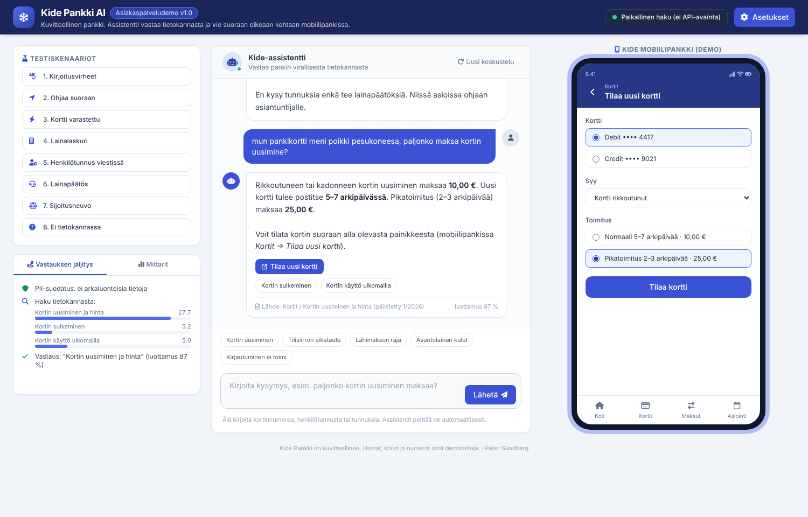
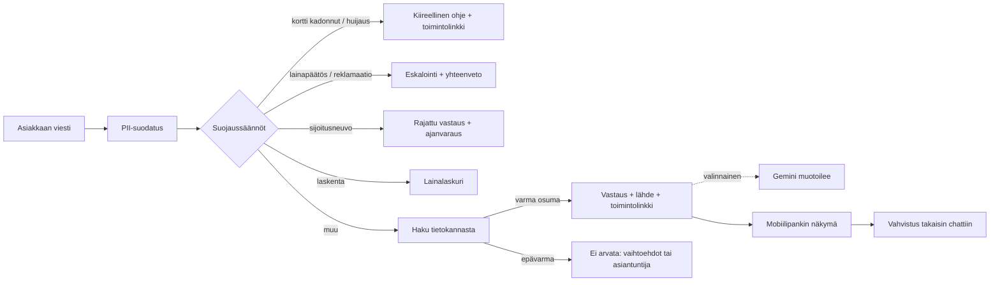

# Kide Pankki AI: asiakaspalveluassistentin demo

**Pankin chat-assistentti, joka vastaa omasta tietokannastaan ja vie asiakkaan suoraan oikeaan kohtaan mobiilipankissa.** Toimii kokonaan selaimessa ilman API-avainta, joten demo vastaa oikeasti myös GitHub Pagesissa.

🔗 **Demo:** https://peterkcs.github.io/kide-pankki-assistentti/

*Kide Pankki on kuvitteellinen. Hinnat, korot ja puhelinnumerot ovat demotietoja.*

## Mitä demo näyttää

| Ominaisuus | Toteutus |
|---|---|
| **Vastaukset tietokannasta** | 25 artikkelia (kortit, maksut, tilit, lainat, tunnukset, turvallisuus). Jokaisessa vastauksessa lähde ja päivityspäivä. |
| **Toimintolinkit** | Vastauksen alla on painike, joka avaa oikean näkymän demomobiilipankissa (esim. *Kortit → Tilaa uusi kortti*). Toiminnon voi tehdä loppuun, ja vahvistus palaa chattiin. |
| **Syvälinkit** | Jokaisella näkymällä on oma URL (`#/kortit/tilaa`, `#/lainat/hae?summa=220000&aika=25`). |
| **"Ohjaa minut suoraan"** | Ohjauspyyntö avaa näkymän automaattisesti, myös edellisen aiheen perusteella. |
| **Kirjoitusvirheiden sieto** | Sanavertailu sietää suomen taivutusta (kortti/kortin) ja kirjainvirheitä (trigrammit). |
| **Ei arvailua** | Jos osuma ei ole riittävän varma, assistentti sanoo sen ja tarjoaa vaihtoehdot tai asiantuntijan. |
| **Suojaukset ennen hakua** | Henkilötunnus, kortinnumero ja IBAN peitetään. Kadonnut kortti ja huijaus ohittavat haun. |
| **Eskalointi** | Lainapäätös, reklamaatio tai turhautuminen siirtää keskustelun asiantuntijalle valmiin yhteenvedon kera. |
| **Sijoitusneuvonnan rajaus** | Ei yksilöllisiä suosituksia, ohjaus asiantuntijalle. |
| **Lainalaskuri** | Tunnistaa summan, ajan ja koron vapaasta tekstistä ja laskee annuiteetin. |
| **Vastauksen jäljitys** | Paneeli näyttää, mitkä suojaukset lauesivat, mitkä artikkelit osuivat ja millä luottamuksella. |
| **Mittarit** | Ratkaisuaste (containment rate), eskaloinnit, suojausten laukeamiset, sovelluksessa tehdyt toiminnot. |
| **Valinnainen Gemini** | Omalla API-avaimella kielimalli muotoilee vastauksen haetuista artikkeleista. Suojaukset ja linkit toimivat silti ennen mallia. |

## Arkkitehtuuri

**Tärkein suunnitteluvalinta:** suojaukset ja toimintolinkit ovat deterministisiä ja toimivat ennen kielimallia. Malli voi muotoilla tekstin, mutta ei päätä, eskaloidaanko keskustelu tai mihin asiakas ohjataan.

## Tiedostot

| Tiedosto | Sisältö |
|---|---|
| `index.html` | Käyttöliittymä, hakumoottori, suojaukset, demomobiilipankki |
| `kb.js` | Tietokanta ja toimintolinkkien kartta (artikkeli → näkymä) |
| `docs/testitapaukset.md` | 14 testitapausta ja testauksessa korjatut virheet |

## Kokeile

Vasemman reunan testiskenaarioissa ovat kirjoitusvirheet, suoran ohjauksen, varastetun kortin, lainalaskurin, henkilötunnuksen viestissä, lainapäätöspyynnön, sijoitusneuvon ja kysymyksen, johon tietokannassa ei ole vastausta.

## Rajoitukset

- Hakusanojen vertailu on kevyt ratkaisu. Tuotannossa käytettäisiin vektorihakua ja pankin oikeaa sisällönhallintaa.
- Demomobiilipankki on simulaatio, eikä se tallenna mitään.
- Gemini-avain on selaimessa, joten live-tila sopii vain omaan testaukseen.

Lisenssi: MIT · Peter Sundberg
